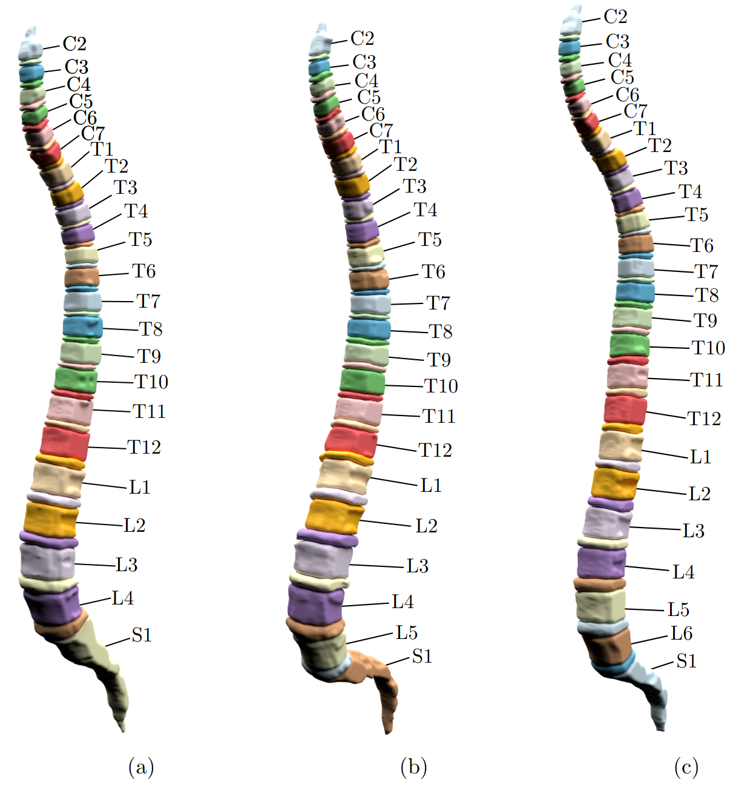
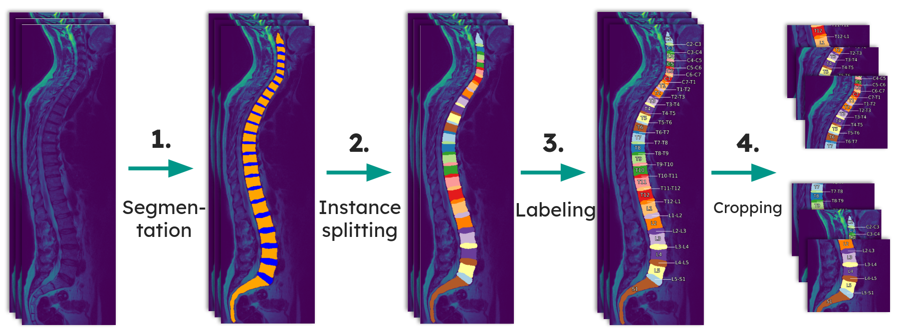
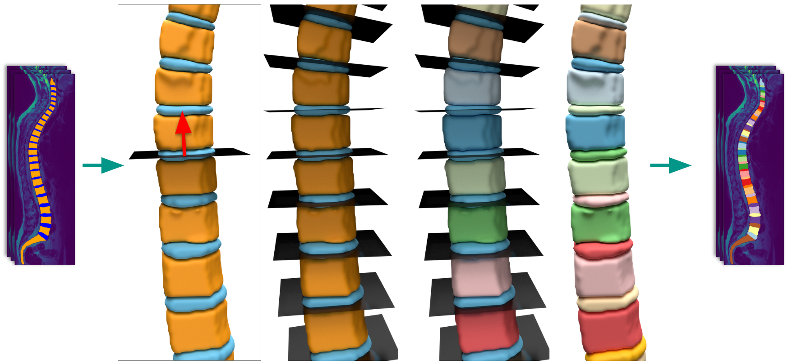
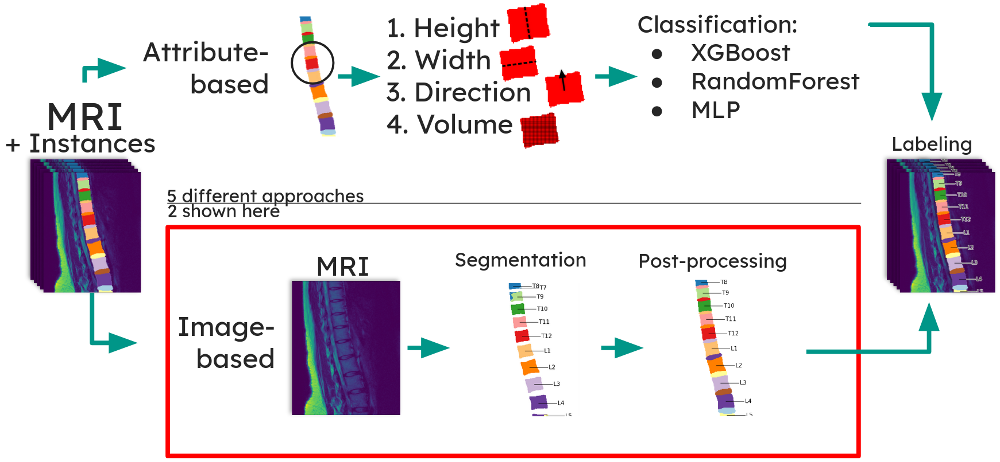
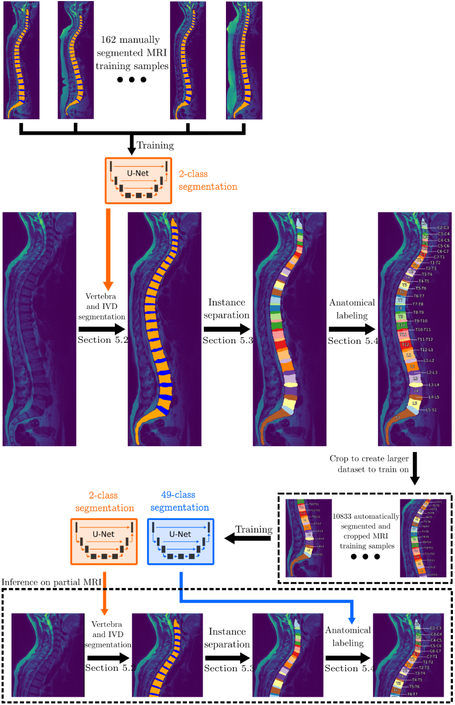

<h1 align="center">Spine Segmentation</h1>

<p align="center">
Anatomical labeling of vertebrae and intervertebral discs (IVDs) in small field-of-view MRI scans.
</p>

<p align="center">
<a href="https://pypi.org/project/spine-segmentation/">PyPI</a> · <a href="https://brutenis.net/master-thesis">Master's Thesis (PDF)</a> · <a href="https://brutenis.net/master-thesis-slides">Slides</a> · <a href="https://github.com/LiquidFun/Spine">GitHub</a>
</p>

This library provides pretrained deep learning models for segmenting and labeling individual vertebrae (C2 to S1) and IVDs in 3D MRI volumes. It works on small field-of-view scans where only part of the spine is visible -- the common case in clinical practice, since full-spine MRIs are expensive and time-consuming.

The approach was developed as part of a [master's thesis](https://brutenis.net/master-thesis) (submitted November 2023) and achieves 85.5% subset accuracy when only ~20% of the spine is visible, improving to 92.6% at \~40% and 94.4% at \~60% visibility.



Above: three spines automatically segmented and labeled. **(a)** shows sacralization (L5 fused with sacrum, only 4 lumbar vertebrae), **(b)** a normal spine, **(c)** lumbarization (additional vertebra L6).

## Installation

```sh
pip install spine-segmentation
```

## Usage

The input should be a 3D numpy array representing an MRI volume (shape: `slices x width x height`). The library handles resizing internally.

```python
import numpy as np
from spine_segmentation import SegmentationInference

# Load your MRI data as a 3D numpy array (e.g. via nibabel or pydicom)
mri_volume = ...  # shape: (num_slices, width, height)

inference = SegmentationInference(
    segmentation_device="CPU",              # or "GPU"
    instance_segmentation_device="CPU",     # or "GPU"
    output_same_shape_as_input=True,        # pad/crop output to match input shape
)

result = inference.segment(mri_volume)

result.semantic_segmentation   # 3D array: 0=background, 1=vertebra, 2=IVD
result.instance_segmentation   # 3D array: each vertebra/IVD has a unique integer ID
result.id_to_label             # dict mapping ID -> anatomical label (e.g. {1: "C2", 2: "C2-C3", ...})
```

For 2D slices, repeat the slice three times to create a minimal 3D volume:

```python
mri_volume = np.tile(single_slice, (3, 1, 1))
```

You can also run only the 2-class segmentation (vertebra vs. IVD, no instance labeling) which is faster:

```python
result = inference.segment(mri_volume, only_2class_segmentation=True)
```

Models are downloaded automatically on first use.

## How it works

The pipeline has three steps:



1. **Segmentation** -- A slice-wise 2D U-Net (ResNet152 encoder, Jaccard loss) segments each sagittal slice into vertebra, IVD, and background. The best model achieved a Dice score of 0.919 on the validation set, outperforming a prior 3D patch-based approach on the same dataset.

2. **Instance splitting** -- Connected vertebra/IVD regions are separated into individual instances. The best method splits along the IVD boundaries using plane fitting, achieving 99.2% valid separations on 10,833 scans.

   

3. **Anatomical labeling** -- A multiclass segmentation model assigns the correct anatomical label (C2, C2-C3, C3, ..., S1) to each instance. Five approaches were evaluated; a direct multiclass U-Net segmentation trained on automatically generated ground truth performed best.

   

The key insight enabling this pipeline is that a large dataset of 10,833 complete MRI scans can be used to generate training data for small-FOV labeling. A model trained on 162 expert-annotated scans first segments the full dataset. Since the topmost vertebra in a complete scan is always C2, all labels can be inferred automatically. Cropped subsets of these labeled scans then serve as training data for the small-FOV labeling model.



## Key results

Subset accuracy (every vertebra and IVD in the scan must be labeled correctly):

| Visible vertebrae | ~% of spine | Subset accuracy | Dice score |
|---|---|---|---|
| V=5 | ~20% | 85.5% | 0.799 |
| V=8 | ~30% | 90.9% | 0.839 |
| V=10 | ~40% | 92.6% | 0.847 |
| V=15 | ~60% | 94.4% | 0.875 |

Without the data generation pipeline (training only on the 162 manually annotated scans), accuracy drops by about 5 percentage points across all FOV sizes, confirming that the automatically generated training data from 10,833 scans is critical.

The pipeline also detected lumbarization in 6.6% and sacralization in 3.6% of the 10,833 patients, roughly consistent with literature (typically ~4.7% each).

## Citation

If you use this work, please cite the master's thesis:

```
Brutenis Gliwa, "Anatomical Labeling of the Spine in Small Field-of-View MRI Scans",
Master's Thesis, University of Rostock, 2023.
```
